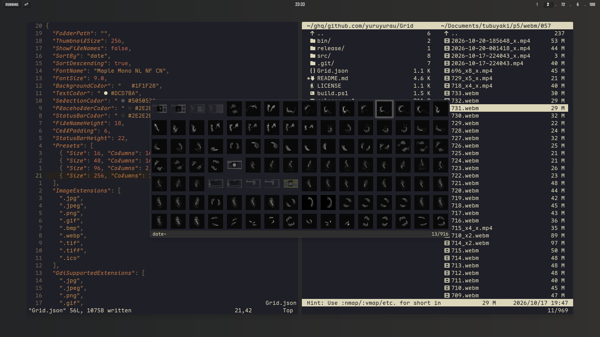

# Grid

A thumbnail grid viewer for images and videos.

<!--  -->


A **Windows application** that displays a grid of thumbnails for images and videos
in a folder. Keyboard-driven, with configurable size presets and sorting.

## Features

- Grid view of image and video thumbnails.
- Keyboard-centric navigation (Vim-like).
- Thumbnail size presets.
- Sorting by name, date, size, extension, etc.
- Configurable via `Grid.toml`.
- Drag files out to Explorer or other applications (copy only).

## Keyboard Shortcuts

| Key                   | Action                                    |
| --------------------- | ----------------------------------------- |
| `h` / `j` / `k` / `l` | Move selection (left / down / up / right) |
| `Enter` / `o` / `i`   | Open selected file                        |
| `Ctrl+J` / `Ctrl+K`   | Increase / decrease thumbnail size        |
| `r`                   | Reload current folder                     |
| `s`                   | Cycle sort key                            |
| `S`                   | Toggle sort direction                     |
| `t`                   | Toggle file names                         |
| `gg`                  | Go to first item                          |
| `G`                   | Go to last item                           |
| `q`                   | Quit                                      |

## Mouse Operations

- **Single click**: Select the thumbnail under the cursor.
- **Double-click**: Open the selected file.
- **Double-click + drag**: Drag the file out of the application (always copies, never moves the original).

> The window can be moved by dragging the status bar.

## Configuration (`Grid.toml`)

Place `Grid.toml` in the same directory as `Grid.exe`.\
Relative paths are resolved relative to the executable.

If the file does not exist or cannot be read, the application starts with
default settings.

Example:

```text
# When FolderPath is empty or omitted, the user's Pictures folder is opened by default.
FolderPath = ""

# Initial thumbnail size on startup.
ThumbnailSize = 256
ShowFileNames = false

# SortBy values:
#   date  - Creation time
#   write - Last write time
#   size  - File size
#   ext   - Extension (then name)
#   name  - File name (default)
SortBy = "date"

SortDescending = true
FontName = "Cascadia Mono"
FontSize = 9.0

BackgroundColor = "#1F1F28"
TextColor = "#DCD7BA"
SelectionColor = "#505053"
PlaceholderColor = "#2E2E2E"
StatusBarColor = "#2E2E2E"

FileNameHeight = 18
CellPadding = 6
StatusBarHeight = 22

# Ctrl+J / Ctrl+K cycles through the sizes defined in Presets.
[[Presets]]
Size = 16
Columns = 16
Rows = 10

[[Presets]]
Size = 48
Columns = 16
Rows = 7

[[Presets]]
Size = 96
Columns = 8
Rows = 4

[[Presets]]
Size = 256
Columns = 3
Rows = 2

ImageExtensions = [".jpg", ".jpeg", ".png", ".gif", ".bmp", ".webp", ".tif", ".tiff", ".ico"]
GdiSupportedExtensions = [".jpg", ".jpeg", ".png", ".gif", ".bmp", ".tif", ".tiff", ".ico"]
VideoExtensions = [".mp4", ".mkv", ".avi", ".mov", ".wmv", ".webm", ".m4v", ".flv", ".mpeg", ".mpg"]
```

## Command-line Options

```text
Grid.exe [options] [folder]
```

| Option                  | Description                                                            |
| ----------------------- | ---------------------------------------------------------------------- |
| `-c`, `--config <path>` | Specify config file path (default: `Grid.toml` next to the executable) |
| `folder`                | Folder to open on startup (overrides `FolderPath` in the config)       |

Examples:

```text
# Open a specific folder
Grid.exe "C:\Photos"

# Use a different config file
Grid.exe --config "C:\Configs\my-grid.toml"

# Combine both
Grid.exe -c custom.toml "C:\Videos"
```

## Integration with vifm

If you place `Grid.exe` and `Grid.toml` in your system PATH, vifm can execute
them directly.

Add the following to your `vifmrc`:

```text
" Define the command to launch the viewer
command! GT :!start "" Grid.exe %"d

" Map a shortcut (e.g., 'gt' to open the grid viewer)
nnoremap gt :GT<cr>
```

## Building

### Prerequisites

This project uses the standard `csc.exe` compiler built into Windows (.NET
Framework 4.x / C# 5 / Compiler version 4.8.x) located at:
`C:\Windows\Microsoft.NET\Framework64\v4.0.30319\csc.exe`

### Build & Release Steps

```text
# 1. Build executable
.\build.ps1
# Produces:
# - bin/Grid.exe
# - bin/Grid.toml (copied from the root Grid.toml)

# 2. Create a distributable zip
.\release.ps1
# Produces:
# - release/Grid.zip (includes LICENSE)
```

## Notes

- Color scheme inspired by the
  [KANAGAWA.nvim](https://github.com/rebelot/kanagawa.nvim).
- Video thumbnails depend on Windows Shell support (same as File Explorer).
- Large folders remain usable because thumbnails are loaded only for the visible
  range.
- Built with `csc.exe` (no .NET SDK required).
- Assisted by [Grok](https://grok.com)
